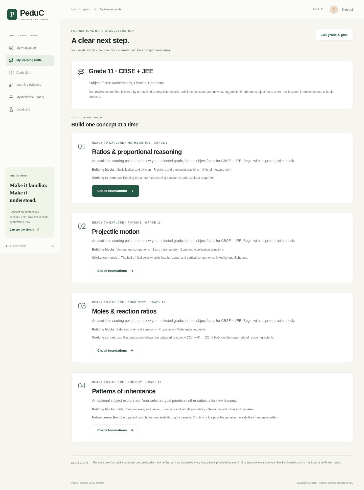
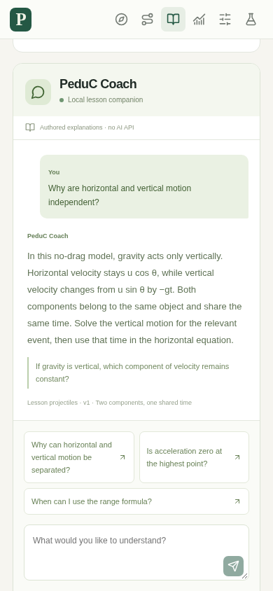

# PeduC

A full-stack development foundation for an English-language learning platform covering mathematics, physics, chemistry, and biology in grades 8–12. The product connects suitable student interests to formal instruction, independent practice, transfer, and delayed review.

The target is CBSE foundations progressing toward JEE, NEET, BITSAT, CUET, TS/AP EAMCET, and KCET. These are **product targets**, not a claim of complete or officially verified coverage in this initial build.

## Get this build from GitHub

The pilot implementation is on the [`codex/peduc-local-pilot` branch](https://github.com/saicharandeep001/Protoype/tree/codex/peduc-local-pilot). Select that branch before using **Code → Download ZIP**, or [download its source ZIP](https://github.com/saicharandeep001/Protoype/archive/refs/heads/codex/peduc-local-pilot.zip). Sign in to GitHub if the repository is private. The default `main` branch will only contain this build after it is merged.

The source download includes the application, lockfile, tests, documentation, and screenshots. Dependencies install on first launch; learner databases and credentials are excluded. Follow [LOCAL_QUICKSTART.md](LOCAL_QUICKSTART.md) after extracting it.

## Application screenshots

Captured from the running local pilot with a generated trial profile. The current P wordmark is temporary pending the supplied logo asset.





## Run locally

Requires Node.js 24 or newer and npm. No domain, email account, or API credentials are required for local testing. From the extracted project folder:

```sh
npm run local
```

The launcher installs locked dependencies on first use, then starts a local server bound to your computer. Open the address printed in the terminal, choose **Start a local trial**, and try the four subjects. Keep the terminal open; press Ctrl+C to stop. Initial dependency installation needs internet access. The lessons and authored text coach require no external API afterward. See [LOCAL_QUICKSTART.md](LOCAL_QUICKSTART.md).

In this cloud environment, run from `/workspace/Protoype` and use `npm_config_cache=/workspace/.npm-cache npm run local` if the default npm cache is not writable. For manual development, `npm ci` and `npm run dev` also work.

For the production compilation and local server:

```sh
npm run build
npm run start
```

The server defaults to port 3000. `GET /api/health` verifies database connectivity. The onboarding interface does not provide a browser preview; use local HTTP requests and browser tests for validation.

Create a test workspace from the application, select your grade, primary goal, and interests, and open a lesson. There are no shared demo credentials or fabricated personal scores.

## Implemented

- Responsive workspace, curriculum browser, learning studio, evidence dashboard, and profile settings.
- Personal learning route prioritizing due reviews, unresolved prerequisite checks, and unfinished sequences before grade-appropriate new lessons. JEE and NEET shape subject priorities; programme-dependent exam choices remain explicit.
- Four short foundation explanations with different worked examples. Reading support before an answer is recorded as assistance; a corrected diagnostic no longer triggers foundation repair.
- Account creation and login; salted scrypt password hashes; random server-side sessions in HTTP-only cookies.
- Persistent learner profiles, interests, primary exam goal, lesson position, answers, hint use, and review scheduling.
- Four development lessons: proportional reasoning, projectile motion, reaction stoichiometry, and monohybrid inheritance.
- Context-specific interactive models, formal notation, worked explanations, and six distinct checks per lesson.
- Server-side numeric grading with restricted input parsing; answer keys are not sent in lesson client props.
- Separate records for hints, retries, independent first passes, unfamiliar transfer, and delayed recall.
- A server-enforced 24-hour delayed review gate after completing each learning sequence.
- Twenty-four initial curriculum roadmap entries, with unavailable content visibly marked as planned.
- PeduC text coach: authored explanations for questions within the current lesson, explicit fallback for unmatched questions, saved conversation, and hint tracking during checks.
- One-click local trial profiles with separate evidence; no email or shared demo password.
- Local pilot page with feedback and an account-scoped JSON evaluation export.
- A proposed content-source register distinguishing candidate references from verified syllabus mappings.

## Important scope

This is a working local pilot application, **not the completed large-scale product**. The four lessons and coach explanations are draft instructional content awaiting educator review. The roadmap is not an exhaustive syllabus. The text coach retrieves authored explanations with lexical matching; it is not an open-ended AI model and can miss valid paraphrases. No speech coach, automated proof/essay grading, official examination bank, teacher administration, payment system, or production-scale deployment is connected. The requested January–February 2027 date is treated as the pilot target, not evidence of complete syllabus readiness.

SQLite stores data locally using Node's built-in `node:sqlite`. This is appropriate for an inspectable development instance. Before a horizontally scaled or serverless deployment, replace the persistence layer with PostgreSQL and managed migrations, integrate production identity, and implement the release work described in [docs/BUILD_PLAN.md](docs/BUILD_PLAN.md). Do not deploy this SQLite build on an ephemeral filesystem and expect records to survive.

## Configuration

See `.env.example`:

- `DATABASE_PATH`: defaults to `.data/context.sqlite`; relative to the repository working directory.
- `SECURE_COOKIES=1`: required for an HTTPS deployment. Use `0` for local HTTP tests.
- `LOCAL_DEMO_ENABLED=1`: enables one-click trial accounts. Disabled by default in production; `npm run local` enables it for the local instance. Regular accounts still work when trials are disabled.

Database initialization is repeatable and does not reset existing data. Back up the SQLite database using a proper SQLite backup operation, or stop the application before copying its database and WAL files. Database files and environment files are ignored by Git.

Account recovery is not implemented. Use test profiles until the deployment and learner-data requirements are agreed. The current application has one learner role.

## Validate

```sh
npm run typecheck
npm test
npm run build
npm run test:e2e
```

End-to-end tests use Chromium at `/usr/bin/chromium` by default; set `CHROMIUM_PATH` for another installed Chromium binary. They start the compiled application on port 3100 and create a dedicated temporary database. They do not use the normal development database. Screenshots and traces are generated under `test-results/` and excluded from Git.

Tests cover strict numeric grading, truthful first-pass evidence, content-bank invariants, registration, profile persistence, independent accounts, hints, unsuccessful and successful attempts, complete lesson flow, delayed review, mobile overflow, coach matching and fallback, schema upgrades, local trials, coach-assisted evidence, private exports, feedback persistence, recommendation priorities, grade/goal changes, foundation support, and returning to the correct learning step. Linux/Chromium is the tested platform; macOS/Windows launcher branches are provided but not yet validated on those systems.

## Main code areas

| Location                | Responsibility                                                |
| ----------------------- | ------------------------------------------------------------- |
| `src/app`               | Routes, server actions, health check, visual system           |
| `src/components`        | Workspace, learning steps, interactions, forms, navigation    |
| `src/lib/lessons.ts`    | Typed draft instructional content and server-side answer keys |
| `src/lib/catalog.ts`    | Interest catalog, target goals, initial curriculum roadmap    |
| `src/lib/assessment.ts` | Numeric parsing, grading, and evidence aggregation            |
| `src/lib/db.ts`         | Local development schema and persistence initialization       |
| `src/lib/auth.ts`       | Password and session handling                                 |
| `src/lib/progress.ts`   | Learner-scoped evidence queries                               |

See [docs/INPUTS_NEEDED.md](docs/INPUTS_NEEDED.md) for the inputs needed to build the complete product. No Git worktree is needed: cloud tasks already have isolated environments, so use this existing checkout.
